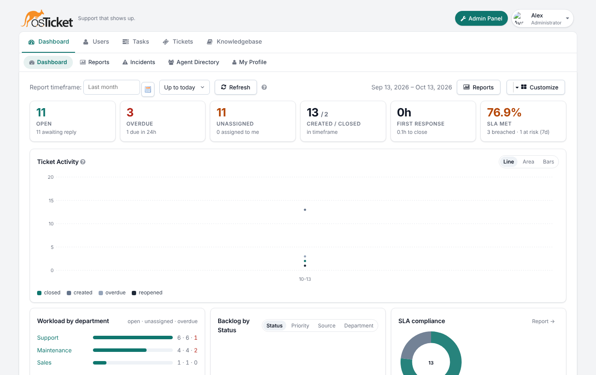
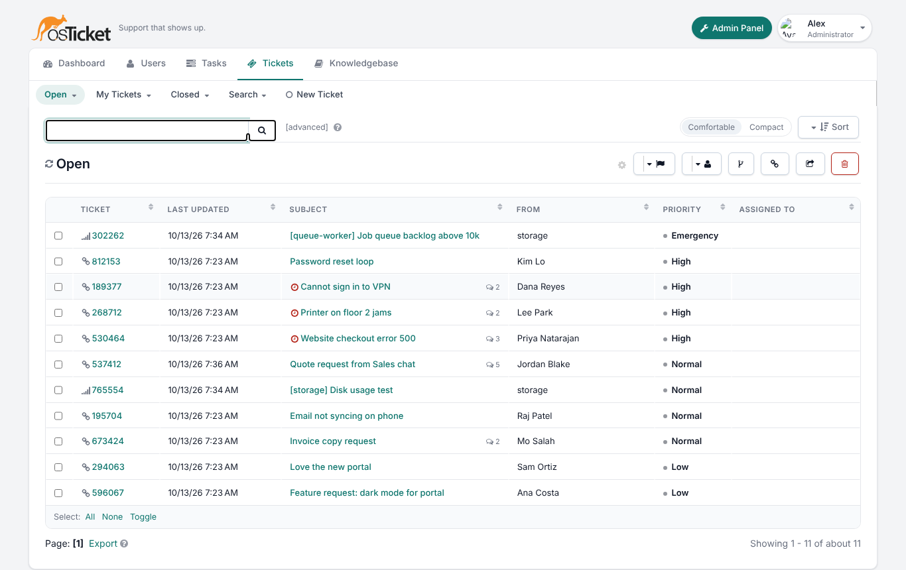
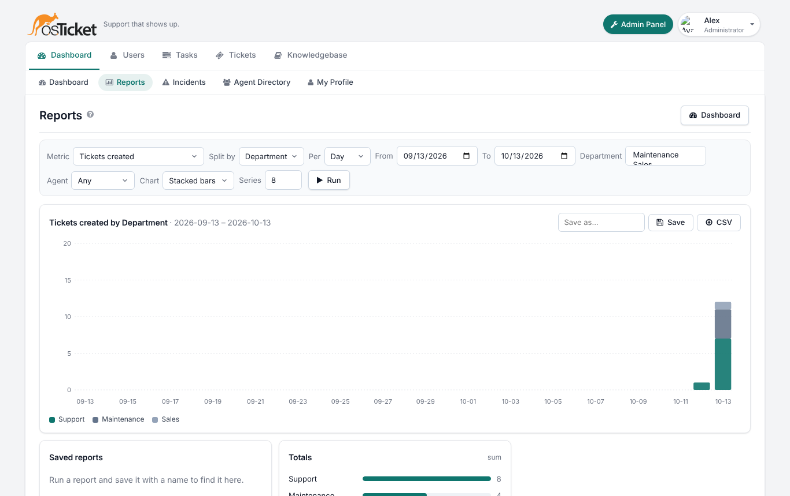
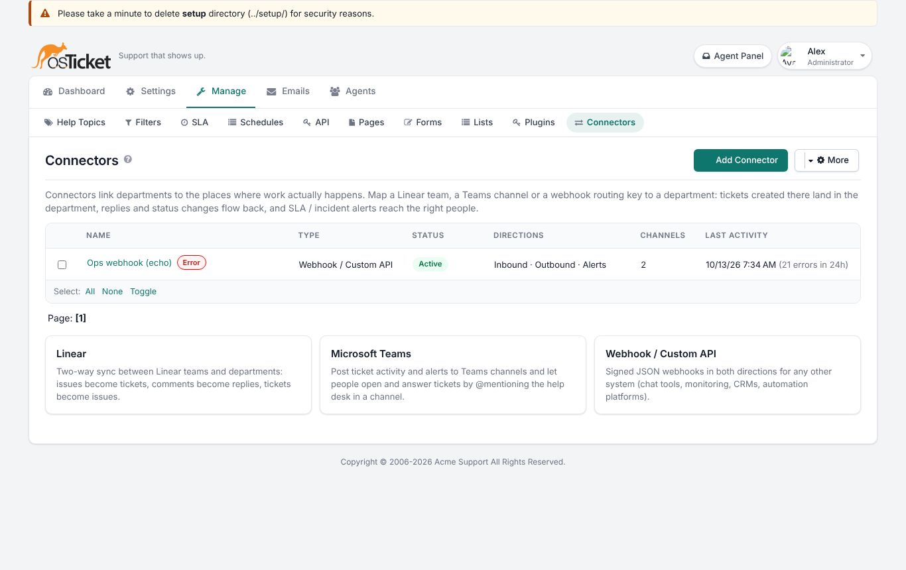
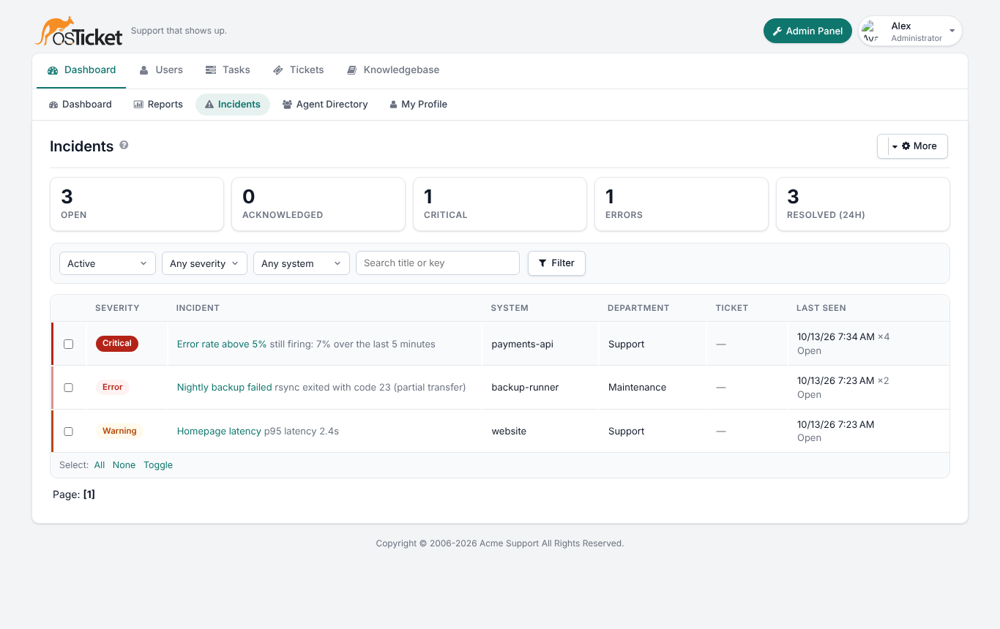

osTicketCustom
==============

A customised build of [osTicket](https://github.com/osTicket/osTicket) (1.18 line)
with a modern, monochrome agent interface, department-aware integrations for
Linear, Microsoft Teams and any webhook-capable system, a system monitoring
API that turns outages into tickets and alerts, richer SLA escalation, and a
dashboard and report builder with configurable charts.

Setup and day-to-day use stay the same as stock osTicket: the installer,
upgrader, help topics, departments, teams, roles, email piping and the REST
API all work as before. Everything new is additive and switched on from the
admin panel.



What is different
-----------------

### Modern interface
  * One neutral design system (`scp/css/modern.css`): a single accent colour,
    glyph icons instead of coloured icon sets, consistent cards, tables,
    forms and dialogs, a slim app bar with an agent menu, and a dark theme
    with a one-click toggle (auto follows the OS preference).
  * Comfortable / compact density, remembered per agent.
  * Ticket list: monochrome source glyphs, SLA due decorations, density
    toggle, cleaner bulk actions.
  * Ticket thread: avatars with initials, entry kind badges (message, reply,
    note), source glyphs, day separators, SLA and "linked in" side cards.
  * Login and client portal restyled to match.



### Branding (Admin Panel → Settings → Branding)
  * Accent colour, light / dark / auto theme, density, navigation style.
  * Display name, tagline, favicon upload, custom CSS, hide "powered by".
  * All of it is applied through CSS variables, so custom CSS stays small.

### Dashboard and reports (Agent Panel → Dashboard)
  * Key numbers (open, overdue, unassigned, created / closed, first
    response, SLA met), ticket activity chart (line / area / bars),
    workload by department, backlog breakdown, SLA compliance, "my work",
    recent activity, integration health and the classic statistics table
    with CSV export. Widgets and chart styles are chosen per agent.
  * Report builder: metric × period × split (department, agent, topic,
    priority, source, status, SLA plan) with date, department and agent
    filters, five chart styles, totals, a data table, CSV export and saved
    presets.



### Connectors (Admin Panel → Manage → Connectors)
Connectors link departments to the places where work happens. Each
connector has channels; a channel maps an external key (a Linear team, a
Teams channel, a webhook routing key) to a department.

  * **Linear** — issues created in a mapped team become tickets, comments
    become replies or notes, state changes close or reopen tickets, and
    ticket replies, notes, assignments and SLA alerts flow back to the
    issue. One Linear API key, as many team → department mappings as you
    need.
  * **Microsoft Teams** — incoming webhooks post ticket activity and alerts
    as adaptive cards to a channel per department; an outgoing webhook lets
    people open and answer tickets by @mentioning the help desk.
  * **Webhook / custom API** — signed JSON events (ticket.created,
    ticket.message, ticket.response, ticket.note, ticket.closed,
    ticket.reopened, ticket.assigned, ticket.transferred, alert) to any URL,
    plus an inbound endpoint (`POST /api/connectors/<id>/webhook`) that
    creates tickets, posts replies and notes and changes status.

Deliveries are queued with retries, every event is logged per connector,
and loop prevention stops an inbound comment from being echoed straight
back. See [docs/INTEGRATIONS.md](docs/INTEGRATIONS.md).



### Departments, channels and access
  * Department → Channels tab shows and edits every connector channel
    mapped to the department.
  * Agents → Access gives a department × role matrix for every agent in
    one place (primary and extended access), with filters.
  * API keys carry scopes: create tickets, read tickets, reply to tickets,
    report incidents, run cron.

### SLA escalation (Admin Panel → Manage → SLA)
  * Targets: resolution grace period, first-response target, warning
    threshold (percentage of the window), pause while awaiting the
    customer.
  * Escalation steps: at N hours after breach raise priority, assign to an
    agent / team / department manager, transfer department, notify people
    and connector channels, add a note. Steps fire from cron.
  * Per-ticket adjustments from the ticket view (extend, set a new due
    date, hold, reset) with a reason, and a full SLA history per ticket.
  * Compliance numbers on the dashboard and in reports.

See [docs/SLA.md](docs/SLA.md).

### Monitoring and incidents (Agent Panel → Dashboard → Incidents)
Any system can report problems with one HTTP call:

```
POST /api/monitor/events.json
X-API-Key: <key with "report incidents">

{"source": "payments-api", "key": "payments-api/error-rate",
 "title": "Error rate above 5%", "severity": "critical", "status": "firing",
 "detail": "502 responses from upstream for the last 5 minutes",
 "department": "Engineering", "url": "https://grafana/…", "tags": ["prod"]}
```

Repeated events with the same key are de-duplicated (occurrences are
counted), a ticket is opened in the mapped department, alerts go to the
department's Linear / Teams / webhook channels with full detail, and a
`"status": "resolved"` event closes the incident and its ticket. Incidents
have their own inbox with acknowledge / resolve actions. See
[docs/MONITORING-API.md](docs/MONITORING-API.md).



### REST API additions
  * `GET /api/tickets.json` (search by status, department, email, number,
    text, assignment, updated-since), `GET /api/tickets/<number>.json`
    (ticket with thread), `POST /api/tickets/<number>/reply|note|message|
    close|reopen|status.json`.
  * `POST /api/monitor/events.json`, `GET /api/monitor/incidents.json`.
  * `POST /api/connectors/<id>/<type>` inbound webhooks.

Requirements
------------
  * HTTP server running Apache, nginx or Microsoft IIS
  * PHP 8.2 – 8.4
  * mysqli extension for PHP
  * MySQL 5.5+ or MariaDB 10+
  * Outbound HTTPS from the web server (and from cron) for connectors

### Recommended PHP extensions
ctype, curl, fileinfo, gd, gettext, iconv, imap, intl, json, mbstring,
Zend OPcache, phar, xml, xml-dom, zip, APCu.

Installation
------------
Identical to osTicket:

  1. Copy the files to your web root (or `git clone` this repository).
  2. Copy `include/ost-sampleconfig.php` to `include/ost-config.php` and
     make it writable for the installer.
  3. Open `http://your-host/setup/` and follow the wizard.
  4. Remove the `setup/` directory and make `include/ost-config.php`
     read-only.
  5. Set up cron (`api/cron.php` or the `POST /api/tasks/cron` endpoint)
     — it also drives SLA escalation, connector retries and incident
     re-notification.

Upgrading an existing osTicket 1.18.x install: copy the files over and open
`/scp/upgrade.php`; the schema patch adds the connector, incident and SLA
tables and new columns. See [docs/UPGRADING.md](docs/UPGRADING.md).

Quick start for integrations
----------------------------
  1. Admin Panel → Settings → Branding: pick the accent colour and theme.
  2. Admin Panel → Manage → Connectors → Add Connector, choose Linear,
     Microsoft Teams or Webhook, paste the credentials, save.
  3. Add a channel per department (the Linear team key, the Teams channel
     and webhook URL, or any routing key), tick inbound / outbound /
     alerts, mark one as the default.
  4. Admin Panel → Manage → API → add a key with the scopes your monitoring
     or automation needs.
  5. Admin Panel → Manage → SLA: set the warning threshold and escalation
     steps per plan.

Everything else — help topics, filters, departments, teams, roles — is
configured exactly as in osTicket.

Documentation
-------------
  * [docs/INTEGRATIONS.md](docs/INTEGRATIONS.md) — Linear, Teams and
    webhook connectors, payloads, loop prevention
  * [docs/MONITORING-API.md](docs/MONITORING-API.md) — incident reporting
    API and the ticket / alert behaviour
  * [docs/SLA.md](docs/SLA.md) — SLA targets, escalation steps, adjustments
  * [docs/BRANDING.md](docs/BRANDING.md) — theme, density, custom CSS,
    favicon
  * [docs/UPGRADING.md](docs/UPGRADING.md) — upgrading from stock osTicket,
    what changed in the schema
  * [docs/screenshots](docs/screenshots) — every page in light and dark

Credits and license
-------------------
Built on osTicket, © 2006–2026 osTicket and contributors. This
customisation keeps the GNU General Public License v2; see
[LICENSE.txt](LICENSE.txt).
